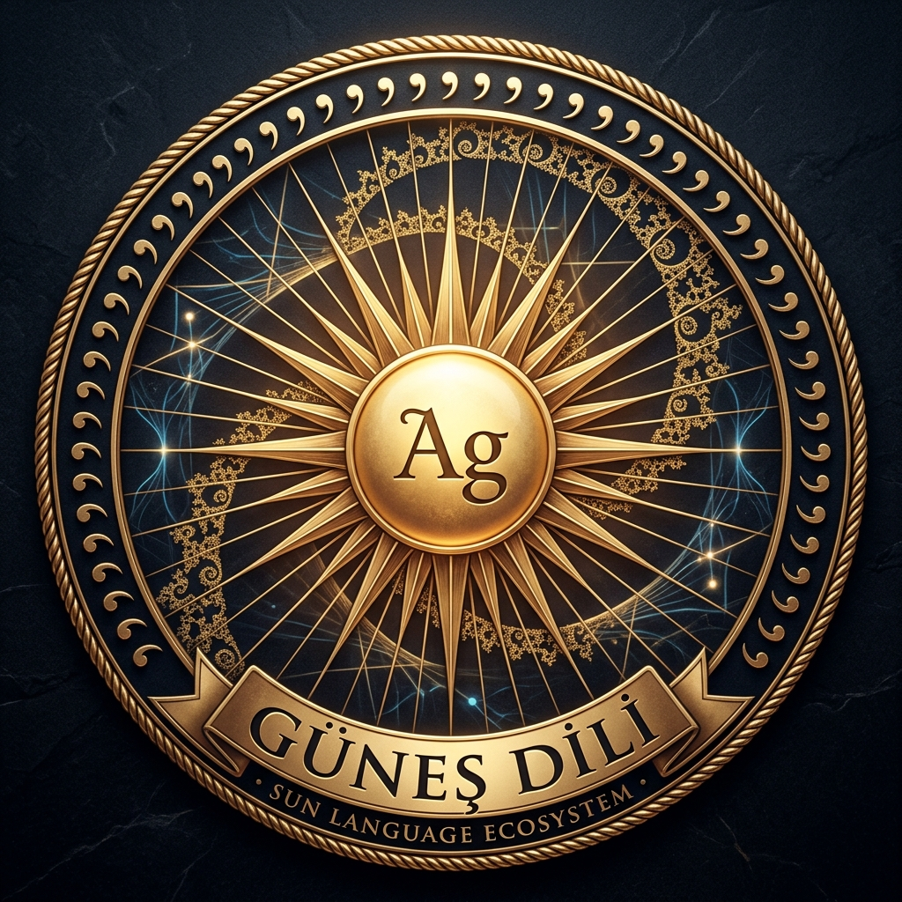

# AG ARTICULATOR
### Morphology, Phonetics & 3D Articulatory Modeling Platform

<p align="center">
  
</p>

<p align="center">
  <strong>Bridging Language, Articulation and Harmonic Acoustics.</strong>
</p>

<p align="center">
  <a href="https://ag-articulator.onrender.com">Live Demo</a> ·
  <a href="#features">Features</a> ·
  <a href="#system-architecture">Architecture</a> ·
  <a href="#scientific-foundation">Scientific Foundation</a>
</p>

---

## 01. Overview

**AG Articulator** is an interactive linguistic and articulatory modeling platform developed by **Persion**.

The project brings together morphological language processing, phonetic analysis, articulatory parameter control and harmonic acoustic modeling within a unified web-based environment.

Built around the AG (Güneş Dili) linguistic ecosystem, the platform provides an interactive interface for exploring how linguistic structures can be represented, decomposed and examined through articulatory and acoustic parameters.

Rather than treating language exclusively as written text, AG Articulator explores the relationship between:

- Linguistic structure
- Morphological composition
- Speech articulation
- Acoustic characteristics
- Harmonic frequency representation

The platform aims to provide an experimental environment for computational linguistics, phonetics and speech technology research.

**Live Application:**  
https://ag-articulator.onrender.com

---

## 02. Core Features

### 2.1. Bidirectional Language Processing

The platform provides two primary linguistic processing directions:

- **Turkish → AG:** Converts Turkish input into the canonical AG representation.
- **AG → Turkish:** Provides reverse linguistic processing from AG structures into Turkish.

These interfaces connect the articulatory environment with the underlying Güneş Dili morphology engine.

### 2.2. Morphological Analysis

Explore the internal structure of words through morphological decomposition.

Core capabilities include:

- Root identification
- Canonical suffix separation
- Morphological structure visualization
- DFA-based linguistic parsing interface
- Examination of root-suffix relationships

### 2.3. AI Linguistic Assistant

An integrated AI conversation interface allows users to submit natural-language questions and explore responses through the AG linguistic environment.

The assistant is designed to connect conversational interaction with the language processing workflow.

### 2.4. Speech Synthesis & Playback

The platform includes interactive speech controls:

- Text-to-speech playback
- Slow playback mode
- Playback interruption
- Linguistic output exploration through audio

### 2.5. Z₅₃ Harmonic & Formant Index

The Z₅₃ module provides an interface for exploring harmonic and acoustic representations.

The interface includes:

| Parameter | Description |
|---|---|
| F₀ | Fundamental frequency |
| F₁ | First formant |
| F₂ | Second formant |
| F₃ | Third formant |
| RMS | Root Mean Square amplitude |
| Z₅₃ | 53-step harmonic index |

The 53-step representation is associated with the harmonic framework of the Güneş Dili ecosystem.

### 2.6. 7-DoF Articulatory Control System

One of the central components of AG Articulator is its seven-degree-of-freedom articulatory parameter interface.

Users can interact with the following parameters:

| Parameter | Articulatory Function |
|---|---|
| Jaw Open | Jaw aperture |
| Tongue X | Tongue position: back ↔ front |
| Tongue Y | Tongue position: low ↔ high |
| Lip Open | Lip aperture |
| Lip Round | Lip rounding |
| Soft Palate | Velum position |
| Glottis | Glottal control |

Additionally, the interface provides F₀ pitch control.

These parameters create an experimental control space for examining the relationship between articulatory configurations and phonetic characteristics.

---

## 03. System Architecture

AG Articulator is organized around interconnected linguistic, articulatory and acoustic components.

```text
                 AG ARTICULATOR
                        |
          +-------------+-------------+
          |             |             |
      LANGUAGE      ARTICULATORY    ACOUSTIC
      PROCESSING       MODELING      ANALYSIS
          |             |             |
     +----+----+    +---+---+     +---+---+
     |         |    |       |     |       |
   TR → AG   AG → TR 7-DoF   F0   F1/F2/F3
     |         |    Control       RMS
     +----+----+       |           |
          |            |           |
          +------------+-----------+
                       |
                AG INTERFACE
                       |
              AI & SPEECH MODULE
```

### Main System Components

| Component | Responsibility |
|---|---|
| Language Engine | Linguistic conversion and processing |
| Morphology Module | Root and suffix decomposition |
| DFA Interface | Deterministic parsing interaction |
| AI Assistant | Natural-language interaction |
| Speech Module | Audio playback and speech interaction |
| Z₅₃ Module | Harmonic index representation |
| Articulatory Controller | Seven-degree-of-freedom parameter control |
| Acoustic Interface | Fundamental frequency and formant indicators |

---

## 04. Scientific Foundation

AG Articulator builds its conceptual framework around the intersection of several technical disciplines.

**Computational Linguistics**

Representation and examination of morphological structures, linguistic roots and suffix relationships.

**Articulatory Phonetics**

Exploration of speech production through controllable articulatory parameters, including jaw, tongue, lips, soft palate and glottis.

**Acoustic Phonetics**

Examination of fundamental frequency, formant structures and signal amplitude.

**Harmonic Modeling**

Exploration of the Z₅₃ harmonic representation associated with the Güneş Dili ecosystem.

**Interactive Computational Modeling**

Combining linguistic and phonetic representations in a single interactive environment.

The underlying Güneş Dili project provides the broader morphological and formal-language research context.

---

## 05. Technology & Implementation

AG Articulator is deployed as a web application.

The live platform is accessible through a modern web browser without requiring a dedicated desktop installation.

The exact implementation stack, dependency versions, API interfaces and deployment configuration are maintained in the project source repository.

---

## 06. Live Application

Experience the interactive system:

<p align="center">
  <a href="https://ag-articulator.onrender.com">
    <strong>OPEN AG ARTICULATOR ↗</strong>
  </a>
</p>

The application provides access to:

1. Turkish-to-AG conversion.
2. AG-to-Turkish processing.
3. Morphological decomposition.
4. AI-assisted linguistic interaction.
5. Speech playback controls.
6. Z₅₃ harmonic and formant interface.
7. Seven-degree-of-freedom articulatory controls.

---

## 07. Research & Development Direction

AG Articulator is an evolving experimental platform.

Potential development directions include:

- Advanced 3D articulatory visualization.
- Real-time articulatory animation.
- Phoneme-level articulation modeling.
- Acoustic parameter analysis.
- Interactive phonetic simulation.
- Integration with speech-processing systems.
- Research-oriented linguistic visualization tools.

These directions represent potential development areas rather than claims of currently implemented functionality.

---

## 08. Related Research Ecosystem

AG Articulator is conceptually connected to the Güneş Dili linguistic ecosystem.

**Core Research Project:**  
[Güneş Dili – GitHub](https://github.com/pCwOrM/gunes-dili)

**Research Portal:**  
[Online Güneş Dili Platform](https://pcworm.github.io/gunes-dili/)

The linguistic engine and its research foundations are maintained independently from the AG Articulator interface.

---

## 09. Development & Attribution

**Project:** AG Articulator  
**Developer / Platform:** Persion  
**Research Ecosystem:** Güneş Dili  
**Interface Version:** v10  
**Deployment:** Render  
**Project Status:** Experimental / Active Development

AG Articulator is developed as an independent interface and experimental modeling environment within the broader linguistic technology ecosystem.

---

## 10. License & Intellectual Property

A☀️ GÜNEŞ DİLİ EKOSİSTEMİ
•
Morfoloji Motoru: Volkan Dağlı & WERR Collaborative Research Group (BSL 1.1)
•
İthaf: github.com/pCwOrM
•
TÜRKPATENT TR 2026/016285 & TR 2026/016633
[ KÜNYE ▲ ]
“Türk dili dillerin en zenginlerindendir; yeter ki bu dil şuurla işlensin.” — Gazi Mustafa Kemal Atatürk, 1935
☀️ GÜNEŞ DİLİ EKOSİSTEMİ & ÇEKİRDEK MOTOR
Güneş Dili Morfoloji Motoru: Volkan Dağlı & WERR Collaborative Research Group • Çekirdek Repo: pCwOrM/gunes-dili (BSL 1.1) • pCwOrM ithafıyla.
⚖️ LİSANS & FİKRİ MÜLKİYET KORUMASI
Business Source License 1.1 (BSL 1.1) • Açık Bilim & Akademik Araştırma Serbestisi (CC-BY-4.0) • ITouch Systems Koruması • TÜRKPATENT TR 2026/016285 & TR 2026/016633
🏛️ BİLİMSEL MİRAS & TELİF
Gazi Mustafa Kemal Atatürk (1935) & Sir Isaac Newton (1664) Bilimsel Mirası • © 2026 Güneş Dili Araştırma İnisiyatifi. Tüm bilimsel, matematiksel ve manevi hakları saklıdır.

---

<p align="center">
  <strong>AG ARTICULATOR</strong>
  <br/>
  <em>Language is more than text. It is structure, motion and sound.</em>
  <br/><br/>
  Developed by <strong>PERSION</strong>
</p>